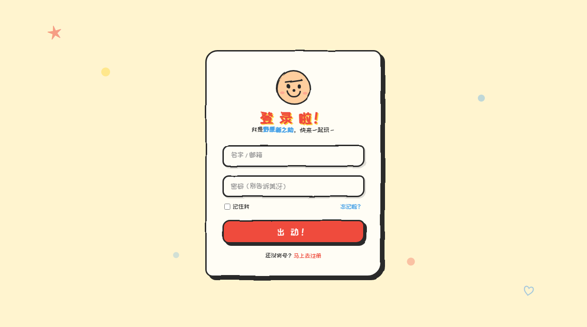
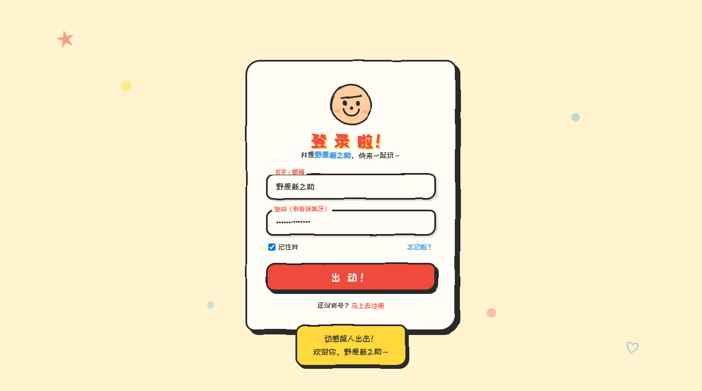

# 蜡笔小新风 · 登录页（Vue 3 + Vite）

由桌面上的单文件 `index.html` 改造而来，视觉与交互保持一致，代码按 Vue 组件化拆分。

## 技术栈

- Vue 3.5（`<script setup>` + `defineModel` + `useId`）
- Vite 8 构建 / 开发服务器（依赖 Node 20.19+ 或 22.12+）
- 纯 CSS（CSS 变量作为设计令牌，无 UI 框架依赖）

## 运行效果

已实测验证（Chrome 无头浏览器真实渲染，构建产物）：



填写表单并提交后的提示气泡：



## 快速开始

```bash
# 安装依赖
npm install

# 启动开发服务器（默认 http://localhost:5173，会自动打开浏览器）
npm run dev

# 生产构建，产物输出到 dist/
npm run build

# 本地预览构建产物
npm run preview
```

## 目录结构

```
shinchan-login-vue/
├── index.html                      # 入口 HTML（只保留 #app 挂载点与字体引入）
├── package.json
├── vite.config.js
└── src/
    ├── main.js                     # 应用入口：创建实例、引入全局样式
    ├── App.vue                     # 根组件：滤镜 + 背景涂鸦 + 登录卡片
    ├── assets/
    │   └── styles/
    │       ├── variables.css       # 设计令牌：颜色 / 圆角 / 阴影 / 动效时长 / 字体
    │       └── global.css          # 重置、页面底色、涂鸦装饰、关键帧动画
    ├── components/
    │   ├── WobbleFilter.vue        # 手绘抖动滤镜（SVG feTurbulence + feDisplacementMap）
    │   ├── ShinchanFace.vue        # 纯 CSS 拼的小新头像
    │   ├── FormField.vue           # 浮动标签输入框（v-model，可复用）
    │   ├── ToastNote.vue           # 手绘风提示气泡（替代 window.alert）
    │   └── LoginCard.vue           # 登录卡片：组装以上组件
    └── composables/
        └── useLoginForm.js         # 登录表单逻辑（数据 / 校验 / 提交 / 反馈）
```

## 改造对照说明

| 原 index.html | 改造后 |
| --- | --- |
| `<style>` 里的 `:root` 变量 | `src/assets/styles/variables.css` 设计令牌 |
| `body`、`#app`、`.scribble`、`@keyframes pop` | `src/assets/styles/global.css` |
| `.face` 那一坨 div | `components/ShinchanFace.vue` |
| `<svg><filter id="wobble">` | `components/WobbleFilter.vue` |
| `.field` 输入框（含浮动标签） | `components/FormField.vue`，用 `v-model` 双向绑定 |
| 内联 `<script>` 的 DOM 取值与 submit 逻辑 | `composables/useLoginForm.js`（响应式状态，无 DOM 查询） |
| 卡片外层结构与样式 | `components/LoginCard.vue`（样式 scoped） |

### 行为保持一致的部分

- 按钮默认文案 `出 动！`，提交过程中变为 `冲 呀！`
- 提交后延迟 600ms 才给出反馈
- 用户名、密码都非空才提交；用户名提交前 `trim()`
- 浮动标签效果：聚焦或已有内容时标签上浮并变红

### 有意的两处改进

1. **`window.alert()` → 页面内提示气泡**（`ToastNote.vue`）。原生 alert 会阻塞渲染且样式无法自定义；文案保持原样（`动感超人出击！\n欢迎你，XXX～`）。
2. **接入真实接口的位置已留好**：`LoginCard.vue` 中 `useLoginForm({ onLogin })` 的 `onLogin` 回调，拿到 `{ username, password, remember }` 后换成 `fetch` / `axios` 即可。

## 后续可以做什么

- 表单校验升级：目前只做非空校验，可换成 `vee-validate` + `zod`
- 组件复用：`FormField` 已支持任意 `label` / `type`，注册页可直接复用
- 状态管理：若后续有多页面，可以引入 `pinia` 存放登录态
- 样式方案：如果项目变大，可考虑 `unocss` 或 `tailwind`，当前纯 CSS 变量已足够
